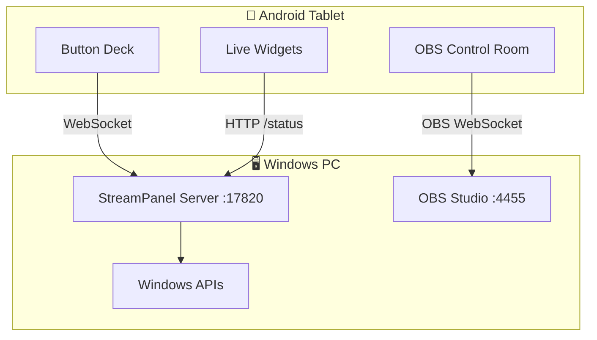
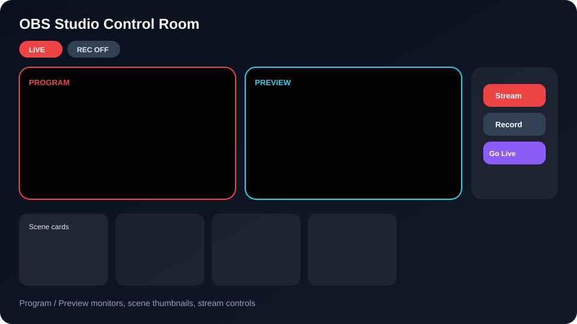
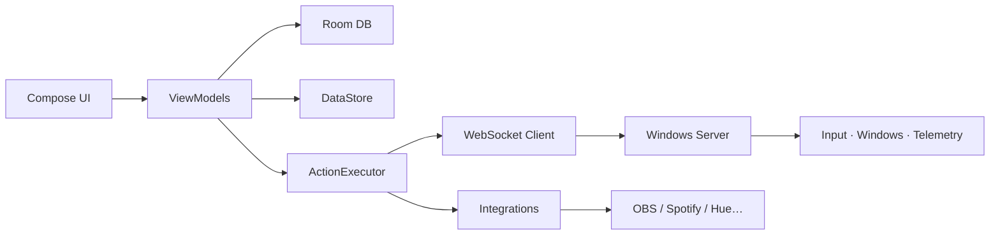

<div align="center">


<br/>

# StreamPanel

**Turn your Android tablet into a premium control deck for your Windows PC.**

Stream · Work · Study · Gaming · Automation · Smart Home — all from one glassy dashboard.

<br/>

[](https://github.com/zibirik/streamdeck/releases/latest)
[](https://github.com/zibirik/streamdeck/actions/workflows/ci.yml)
[](LICENSE)
[](https://developer.android.com/)
[](https://www.microsoft.com/windows)

### [⬇ Download the latest release](https://github.com/zibirik/streamdeck/releases/latest)

[Install](#-install) · [Features](#-features) · [Screenshots](#-screenshots) · [Security](#-security) · [Build from source](#-build-from-source) · [License](#-license--commercial-use) · [Русский](README.ru.md)

</div>

---

## What is StreamPanel?

StreamPanel is a **two-part system**:

| Part | Role |
|------|------|
| **Android app** | Beautiful tablet UI — button deck, widgets, OBS room, macros |
| **Windows server** | Small companion on your PC — executes commands, sends live telemetry |

Press a button on the tablet → your PC opens apps, sends hotkeys, switches OBS scenes, snaps windows, or runs a full macro chain.



> **Two connections, not one:** the PC server uses port **17820**. OBS uses its own WebSocket on port **4455**.

---

## Install

You do **not** need Android Studio, .NET or any developer tools. Everything is on the
[Releases page](https://github.com/zibirik/streamdeck/releases/latest).

| File | Where | What it is |
|------|-------|------------|
| `StreamPanel-Server-vX.Y.Z-win-x64.zip` | Windows 10/11 PC | The companion server (self-contained, nothing else to install) |
| `StreamPanel-vX.Y.Z.apk` | Android 8.0+ tablet or phone | The app |
| `SHA256SUMS.txt` | — | Checksums to verify your downloads |

### 1 · On the PC

1. Download and unzip `StreamPanel-Server-…-win-x64.zip`.
2. **Set a PIN** — open `appsettings.json`, set `"Pin": "your-pin"` (see [Security](#-security)).
3. Run `START-SERVER.bat`. Allow the Windows firewall prompt (or run `ALLOW-FIREWALL.bat` as administrator).
4. The console shows your PC's addresses, e.g. `ws://192.168.1.76:17820/ws`.

### 2 · On the tablet

1. Download `StreamPanel-…apk` to the tablet and open it (allow "install unknown apps" for your browser/file manager once).
2. Open StreamPanel → **Settings** → enter your PC's IP address, port `17820` and the **same PIN**.
3. Tap a button on the deck — your PC reacts.

Both devices must be on the **same Wi‑Fi network**. Updating later = install the new APK over the old one and replace the server folder
(keep your `appsettings.json`).

> **Windows SmartScreen** may warn about an unsigned executable the first time ("More info" → "Run anyway").
> You can compare the file against `SHA256SUMS.txt`, or [build it yourself](#-build-from-source).

---

## Features

<table>
<tr>
<td width="50%" valign="top">

### Dashboard & Deck
- Custom grid **2×2 … 12×12**
- Layers, folders, toggle buttons
- Drag & drop layout
- 9 themes + custom accent + glass UI
- Import / export deck as JSON

### Streaming
- **OBS Control Room** — Program / Preview monitors
- Stream, record, pause, studio mode
- Scene cards with thumbnails
- Twitch & YouTube chat embed
- Stream health (FPS, dropped frames)

### Productivity
- Pomodoro focus timer
- Time tracker with projects
- Clipboard sync PC ↔ tablet
- Quick actions row (Alt+Tab, screenshot…)
- Study & meeting mode packs

</td>
<td width="50%" valign="top">

### PC Control
- Open URLs & launch apps
- Hotkeys & typed text
- Window snap, multi-monitor
- Volume, media keys, mouse
- Sleep, lock, task manager, git, docker

### Gaming
- **CS2 Game State Integration**
- Health, armor, ammo, map, score
- Auto-detect game by process name

### Integrations
- OBS WebSocket 5.x
- Spotify · Discord webhook · Streamlabs
- Philips Hue · Home Assistant · MQTT
- TCP / UDP raw packets

</td>
</tr>
</table>

---

## Screenshots

> Illustrations below ship with the repo. Drop real tablet screenshots into `docs/images/` to replace them anytime.

<table>
<tr>
<td align="center" width="50%">

<br/><sub><b>Dashboard</b> — deck + sidebar + tools column</sub>
</td>
<td align="center" width="50%">

<br/><sub><b>OBS Studio</b> — Program / Preview + scene cards</sub>
</td>
</tr>
</table>

<details>
<summary><b>More panels & tools</b></summary>

<br/>

| Panel | What it does |
|-------|----------------|
| Hardware Monitor | CPU, RAM, all drives, network |
| Process Monitor | Top processes, tap to kill |
| Stream Chat | Embedded Twitch / YouTube chat |
| Game Status | CS2 HUD via GSI |
| PC Configurator | Link to web setup on your PC |
| Discord / Dev Tools | Shortcuts for daily workflows |
| Time Tracker | Projects + session log |

</details>

---

## Security

The server can run actions on your PC (launch programs, send keystrokes, manage windows), so please read this once.

- **Set a PIN.** Windows: `appsettings.json` → `"StreamPanel": { "Pin": "your-pin" }`, restart the server. Tablet: Settings → PIN code → same value.
  Without a PIN, **anyone on your Wi‑Fi can control your PC** (the server console prints a warning).
- With a PIN, every remote connection must authenticate first; `/status`, `/api/configurator/*` and `/integrations/*` require it as well;
  5 wrong attempts lock that IP out for a minute. Requests from the PC itself are always allowed.
- `OPEN_URL` accepts only allow‑listed schemes (`http`, `https`, `steam`, `spotify`, `discord`, …) — configurable in `appsettings.json`.
- Traffic is plain HTTP/WebSocket on your local network. Use a network you trust and **never forward port 17820 to the internet**
  (use a VPN for remote access).
- Found a vulnerability? Please report it privately — see [`SECURITY.md`](SECURITY.md).

## Privacy

StreamPanel has **no accounts, no analytics and no telemetry**. Your deck and settings stay on your devices. The tablet talks only to
your own PC and to the services *you* configure (OBS, Spotify, Hue, Home Assistant, …). Tokens and the PIN are stored on the tablet
and excluded from Android backups.

---

## Windows server API

Default port: **17820** (change it with `StreamPanel:Port`).

| Endpoint | Description | PIN |
|----------|-------------|-----|
| `GET /api` | Name, version, machine name, `pinRequired` (used for LAN discovery) | no |
| `GET /` | PC Configurator web UI | no (API calls need it) |
| `GET /status` | Live PC telemetry | yes |
| `WS /ws` | Command channel from tablet | yes (`auth` command) |
| `POST /integrations/cs2/gsi` | Counter-Strike 2 GSI | yes (`?pin=`) |
| `GET/POST /api/configurator/draft` | Web configurator drafts | yes |

Protocol details: [`docs/protocol.md`](docs/protocol.md)

---

## OBS setup

1. OBS → **Tools → WebSocket Server Settings**
2. Enable server, set password (default port **4455**)
3. In StreamPanel → **OBS Studio**:
   - URL: `ws://YOUR_PC_IP:4455`
   - Password: your OBS password

No need to start streaming manually before connecting — WebSocket works as soon as OBS is open.

---

## Troubleshooting

<details>
<summary><b>Tablet can't connect to PC</b></summary>

- Server running? (`START-SERVER.bat`)
- Correct PC IP? (`ipconfig` → Wi‑Fi IPv4). Open `http://PC_IP:17820/api` in the tablet's browser — you should see JSON.
- Firewall open? (`ALLOW-FIREWALL.bat` as administrator)
- Same Wi‑Fi network, no "client isolation" on the router, no VPN active on either device
- PIN identical on both sides? A wrong PIN shows as a connection error in the app.

</details>

<details>
<summary><b>OBS says wrong stream key / channel error</b></summary>

StreamPanel **did connect** — OBS tried to start the stream but rejected your stream settings.

Fix in OBS: **Settings → Stream** (service, server, stream key).

</details>

<details>
<summary><b>CS2 HUD not updating</b></summary>

1. Download the GSI config from `http://PC_IP:17820/` → CS2 HUD tab (it already contains your PIN)
2. Place it in `csgo/cfg/`
3. Restart CS2
4. Check `http://PC_IP:17820/integrations/cs2/status`

</details>

---

## Build from source

Requirements: Windows, .NET 8 SDK (or newer), JDK 17, Android SDK (platform 35).

```powershell
git clone https://github.com/zibirik/streamdeck.git
cd streamdeck
.\tools\check-prereqs.ps1
.\tools\test-server.ps1        # server unit tests
.\tools\build-android.ps1      # debug APK → android\app\build\outputs\apk\debug\
.\tools\run-server.ps1         # run the server locally
```

| Command | Result |
|---------|--------|
| `.\tools\build-all.ps1` | Tests + server + APK |
| `.\tools\build-android.ps1` | Debug APK only |
| `.\tools\test-server.ps1` | Server unit tests |
| `.\tools\run-server.ps1` | Start the server locally |
| `.\tools\package-release.ps1 -Version 1.0.0` | Release files in `dist\release\` |
| `.\tools\create-keystore.ps1` | One-time Android signing key for releases |

If PowerShell refuses to run scripts: `Set-ExecutionPolicy -Scope CurrentUser RemoteSigned`.
Maintainers: see [`docs/releasing.md`](docs/releasing.md) for how releases are published.

### Architecture



| Layer | Tech |
|-------|------|
| Android UI | Kotlin, Jetpack Compose, Material 3, Hilt |
| Persistence | Room (deck), DataStore (settings) |
| Network | Ktor WebSocket + HTTP |
| Windows server | .NET 8, ASP.NET Core Minimal APIs |
| Protocol | JSON over WebSocket v1 |

```text
streamdeck/
├── android/                 # Kotlin tablet app (app, core/*, feature/*)
├── server/windows/          # .NET companion server + unit tests
├── tools/                   # Build, test & release scripts (PowerShell)
├── docs/                    # Architecture, protocol, releasing, images
└── .github/                 # CI and release workflows, issue templates
```

---

## Documentation

| File | Content |
|------|---------|
| [`docs/architecture.md`](docs/architecture.md) | System design |
| [`docs/protocol.md`](docs/protocol.md) | WebSocket protocol, authentication, limits |
| [`docs/plugin-sdk.md`](docs/plugin-sdk.md) | Plugin contracts |
| [`docs/releasing.md`](docs/releasing.md) | How releases are built and published |
| [`docs/roadmap.md`](docs/roadmap.md) | Roadmap stages |
| [`CHANGELOG.md`](CHANGELOG.md) | What changed in each version |

---

## Contributing & support

- Bugs and ideas: [open an issue](https://github.com/zibirik/streamdeck/issues/new/choose).
- Pull requests are welcome — see [`CONTRIBUTING.md`](CONTRIBUTING.md) (please read the contribution terms).
- Security reports: [`SECURITY.md`](SECURITY.md).

---

## License & commercial use

StreamPanel is **source-available** under the [PolyForm Noncommercial License 1.0.0](LICENSE).

| You are… | Cost |
|----------|------|
| An individual using it for yourself, hobby, study or research | **Free** |
| A school, charity or public institution | **Free** |
| A company, studio or agency; client work; business / monetised use; reselling or embedding it | **Commercial license required** — see [`COMMERCIAL.md`](COMMERCIAL.md) |

Not sure? [Ask in an issue](https://github.com/zibirik/streamdeck/issues/new/choose).
Third-party software and trademarks: [`NOTICE.md`](NOTICE.md). StreamPanel is independent and not affiliated with Elgato/Corsair
("Stream Deck" is their trademark), OBS, Spotify, Discord, Valve or any other mentioned brand.

---

<div align="center">

**Made for streamers, builders, and power users who want their tablet to feel like mission control.**

<br/>

[⬆ Back to top](#streampanel) · [Русская версия](README.ru.md)

</div>
