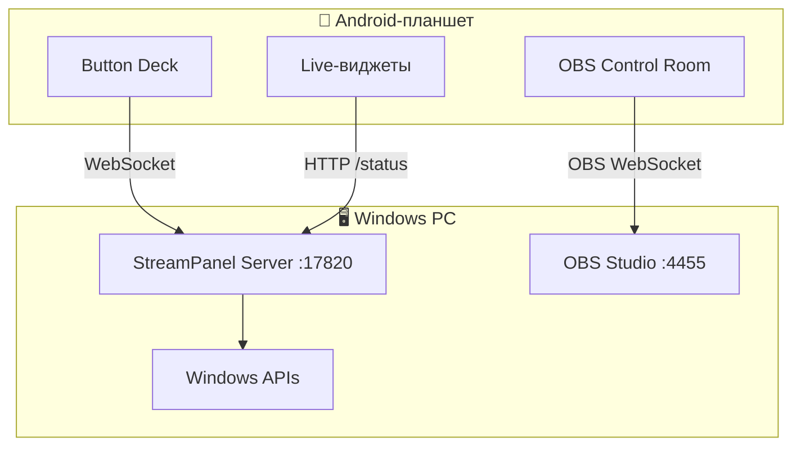
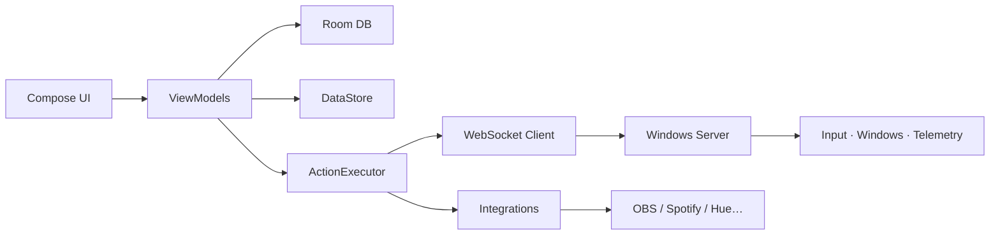

<div align="center">


<br/>

# StreamPanel

**Преврати Android-планшет в стильную панель управления для Windows PC.**

Стриминг · Работа · Учёба · Игры · Автоматизация · Smart Home — всё с одного dashboard.

<br/>

[](https://github.com/zibirik/streamdeck/releases/latest)
[](https://github.com/zibirik/streamdeck/actions/workflows/ci.yml)
[](LICENSE)
[](https://developer.android.com/)
[](https://www.microsoft.com/windows)

### [⬇ Скачать последнюю версию](https://github.com/zibirik/streamdeck/releases/latest)

[Установка](#установка) · [Функции](#функции) · [Скриншоты](#скриншоты) · [Безопасность](#безопасность) · [Сборка из исходников](#сборка-из-исходников) · [Лицензия](#лицензия-и-коммерческое-использование) · [English](README.md)

</div>

---

## Что такое StreamPanel?

StreamPanel — это **две части**, которые работают вместе:

| Компонент | Роль |
|-----------|------|
| **Android-приложение** | Красивый UI на планшете — deck, виджеты, OBS room, макросы |
| **Windows server** | Небольшая программа на ПК — выполняет команды, отдаёт telemetry |

Нажал кнопку на планшете → ПК открывает программы, шлёт hotkeys, переключает сцены OBS, расставляет окна или запускает цепочку макросов.



> **Два подключения, не одно:** PC server — порт **17820**. OBS — свой WebSocket на порту **4455**.

---

## Установка

Android Studio, .NET и другие инструменты разработчика **не нужны**. Всё лежит на странице
[Releases](https://github.com/zibirik/streamdeck/releases/latest).

| Файл | Куда | Что это |
|------|------|---------|
| `StreamPanel-Server-vX.Y.Z-win-x64.zip` | ПК с Windows 10/11 | Сервер (всё внутри, ничего ставить не нужно) |
| `StreamPanel-vX.Y.Z.apk` | Планшет/телефон Android 8.0+ | Приложение |
| `SHA256SUMS.txt` | — | Контрольные суммы для проверки загрузок |

### 1 · На ПК

1. Скачай и распакуй `StreamPanel-Server-…-win-x64.zip`.
2. **Задай PIN** — открой `appsettings.json`, укажи `"Pin": "твой-пин"` (см. [Безопасность](#безопасность)).
3. Запусти `START-SERVER.bat`. Разреши доступ в брандмауэре (или запусти `ALLOW-FIREWALL.bat` от администратора).
4. В консоли появятся адреса ПК, например `ws://192.168.1.76:17820/ws`.

### 2 · На планшете

1. Скачай `StreamPanel-…apk` на планшет и открой его (один раз разреши «установку из неизвестных источников» для браузера/файлового менеджера).
2. Открой StreamPanel → **Настройки** → введи IP ПК, порт `17820` и **тот же PIN**.
3. Нажми кнопку на деке — ПК отреагирует.

Оба устройства должны быть в **одной Wi‑Fi сети**. Обновление: установи новый APK поверх старого и замени папку сервера
(свой `appsettings.json` сохрани).

> **Windows SmartScreen** может предупредить о неподписанной программе при первом запуске («Подробнее» → «Выполнить в любом случае»).
> Можно сверить файл с `SHA256SUMS.txt` или [собрать самому](#сборка-из-исходников).

---

## Функции

<table>
<tr>
<td width="50%" valign="top">

### Dashboard и Deck
- Сетка **2×2 … 12×12**
- Слои, папки, toggle-кнопки
- Drag & drop
- 9 тем + accent + glass UI
- Импорт / экспорт deck в JSON

### Стриминг
- **OBS Control Room** — Program / Preview
- Stream, record, pause, studio mode
- Карточки сцен с preview
- Twitch & YouTube chat
- Stream health (FPS, dropped frames)

### Продуктивность
- Pomodoro / Focus timer
- Time tracker с проектами
- Clipboard PC ↔ планшет
- Quick actions (Alt+Tab, screenshot…)
- Study & meeting packs

</td>
<td width="50%" valign="top">

### Управление ПК
- URL и запуск программ
- Hotkeys и ввод текста
- Snap окон, несколько мониторов
- Громкость, media keys, мышь
- Sleep, lock, task manager, git, docker

### Игры
- **CS2 Game State Integration**
- HP, armor, ammo, map, score
- Авто-детект игры по exe

### Интеграции
- OBS WebSocket 5.x
- Spotify · Discord · Streamlabs
- Philips Hue · Home Assistant · MQTT
- TCP / UDP

</td>
</tr>
</table>

---

## Скриншоты

> Ниже — иллюстрации из репозитория. Можешь заменить их реальными скринами планшета в `docs/images/`.

<table>
<tr>
<td align="center" width="50%">

<br/><sub><b>Dashboard</b> — deck + sidebar + tools column</sub>
</td>
<td align="center" width="50%">

<br/><sub><b>OBS Studio</b> — Program / Preview + scene cards</sub>
</td>
</tr>
</table>

<details>
<summary><b>Ещё панели и инструменты</b></summary>

<br/>

| Панель | Что делает |
|--------|------------|
| Hardware Monitor | CPU, RAM, все диски, сеть |
| Process Monitor | Top processes, kill по tap |
| Stream Chat | Twitch / YouTube chat |
| Game Status | CS2 HUD через GSI |
| PC Configurator | Веб-настройка с ПК |
| Discord / Dev Tools | Ярлыки для работы |
| Time Tracker | Проекты + лог времени |

</details>

---

## Безопасность

Сервер умеет выполнять действия на ПК (запуск программ, ввод с клавиатуры, управление окнами), поэтому прочитай это один раз.

- **Задай PIN.** Windows: `appsettings.json` → `"StreamPanel": { "Pin": "твой-пин" }`, перезапусти сервер. Планшет: Настройки → PIN-код → то же значение.
  Без PIN **любой в твоей Wi‑Fi сети может управлять ПК** (в консоли сервера будет предупреждение).
- С PIN каждое удалённое подключение сначала авторизуется; `/status`, `/api/configurator/*` и `/integrations/*` тоже требуют PIN;
  после 5 неверных попыток IP блокируется на минуту. Запросы с самого ПК всегда разрешены.
- `OPEN_URL` принимает только разрешённые схемы (`http`, `https`, `steam`, `spotify`, `discord`, …) — список в `appsettings.json`.
- Трафик идёт по обычному HTTP/WebSocket внутри локальной сети. Используй доверенную сеть и **никогда не пробрасывай порт 17820 в интернет**
  (для удалённого доступа — VPN).
- Нашёл уязвимость? Сообщи приватно — см. [`SECURITY.md`](SECURITY.md).

## Приватность

В StreamPanel **нет аккаунтов, аналитики и телеметрии**. Deck и настройки остаются на твоих устройствах. Планшет общается только
с твоим ПК и с сервисами, которые *ты* настроил (OBS, Spotify, Hue, Home Assistant, …). Токены и PIN хранятся на планшете и
исключены из резервных копий Android.

---

## Windows server API

Порт по умолчанию: **17820** (меняется через `StreamPanel:Port`).

| Endpoint | Описание | PIN |
|----------|----------|-----|
| `GET /api` | Имя, версия, имя ПК, `pinRequired` (для поиска в сети) | нет |
| `GET /` | PC Configurator (веб UI) | нет (запросы к API — да) |
| `GET /status` | Live telemetry ПК | да |
| `WS /ws` | Команды с планшета | да (команда `auth`) |
| `POST /integrations/cs2/gsi` | Counter-Strike 2 GSI | да (`?pin=`) |
| `GET/POST /api/configurator/draft` | Draft веб-конфигуратора | да |

Протокол: [`docs/protocol.md`](docs/protocol.md)

---

## Настройка OBS

1. OBS → **Tools → WebSocket Server Settings**
2. Включить server, задать пароль (порт **4455**)
3. В StreamPanel → **OBS Studio**:
   - URL: `ws://IP_ПК:4455`
   - Password: пароль OBS

Трансляцию вручную начинать не нужно — WebSocket работает, пока OBS открыт.

---

## Troubleshooting

<details>
<summary><b>Планшет не подключается к ПК</b></summary>

- Server запущен? (`START-SERVER.bat`)
- Верный IP? (`ipconfig` → Wi‑Fi IPv4). Открой в браузере планшета `http://IP_ПК:17820/api` — должен показаться JSON.
- Firewall? (`ALLOW-FIREWALL.bat` от администратора)
- Одна Wi‑Fi сеть, без client isolation на роутере, без включённого VPN на обоих устройствах
- PIN одинаковый с обеих сторон? Неверный PIN показывается в приложении как ошибка подключения.

</details>

<details>
<summary><b>OBS пишет ошибку ключа / канала</b></summary>

StreamPanel **подключился** — OBS попытался начать эфир, но отклонил настройки трансляции.

Исправь в OBS: **Settings → Stream** (сервис, server, stream key).

</details>

<details>
<summary><b>CS2 HUD не обновляется</b></summary>

1. Скачай GSI config: `http://IP_ПК:17820/` → вкладка CS2 HUD (PIN уже внутри файла)
2. Положи в `csgo/cfg/`
3. Перезапусти CS2
4. Проверь `http://IP_ПК:17820/integrations/cs2/status`

</details>

---

## Сборка из исходников

Нужно: Windows, .NET 8 SDK (или новее), JDK 17, Android SDK (platform 35).

```powershell
git clone https://github.com/zibirik/streamdeck.git
cd streamdeck
.\tools\check-prereqs.ps1
.\tools\test-server.ps1        # unit-тесты сервера
.\tools\build-android.ps1      # debug APK → android\app\build\outputs\apk\debug\
.\tools\run-server.ps1         # запуск сервера
```

| Команда | Результат |
|---------|-----------|
| `.\tools\build-all.ps1` | Тесты + server + APK |
| `.\tools\build-android.ps1` | Только debug APK |
| `.\tools\test-server.ps1` | Тесты сервера |
| `.\tools\run-server.ps1` | Запуск server локально |
| `.\tools\package-release.ps1 -Version 1.0.0` | Файлы релиза в `dist\release\` |
| `.\tools\create-keystore.ps1` | Одноразовый ключ подписи Android для релизов |

Если PowerShell не запускает скрипты: `Set-ExecutionPolicy -Scope CurrentUser RemoteSigned`.
Для мейнтейнеров: как публикуются релизы — [`docs/releasing.md`](docs/releasing.md).

### Архитектура



| Слой | Стек |
|------|------|
| Android UI | Kotlin, Jetpack Compose, Material 3, Hilt |
| Хранение | Room (deck), DataStore (настройки) |
| Сеть | Ktor WebSocket + HTTP |
| Windows server | .NET 8, ASP.NET Core Minimal APIs |
| Протокол | JSON over WebSocket v1 |

```text
streamdeck/
├── android/                 # Kotlin tablet app (app, core/*, feature/*)
├── server/windows/          # .NET companion server + unit-тесты
├── tools/                   # Скрипты сборки, тестов и релиза (PowerShell)
├── docs/                    # Архитектура, протокол, релизы, картинки
└── .github/                 # CI, release workflow, шаблоны issue
```

---

## Документация

| Файл | Содержание |
|------|------------|
| [`docs/architecture.md`](docs/architecture.md) | Архитектура |
| [`docs/protocol.md`](docs/protocol.md) | WebSocket протокол, авторизация, лимиты |
| [`docs/plugin-sdk.md`](docs/plugin-sdk.md) | Plugin API |
| [`docs/releasing.md`](docs/releasing.md) | Как собираются и публикуются релизы |
| [`docs/roadmap.md`](docs/roadmap.md) | Roadmap |
| [`CHANGELOG.md`](CHANGELOG.md) | Что изменилось в каждой версии |

---

## Участие и поддержка

- Баги и идеи: [создай issue](https://github.com/zibirik/streamdeck/issues/new/choose).
- Pull request'ы приветствуются — см. [`CONTRIBUTING.md`](CONTRIBUTING.md) (прочитай условия для контрибьюторов).
- Уязвимости: [`SECURITY.md`](SECURITY.md).

---

## Лицензия и коммерческое использование

Код StreamPanel **доступен для чтения** по лицензии [PolyForm Noncommercial 1.0.0](LICENSE).

| Кто ты | Стоимость |
|--------|-----------|
| Частное лицо: для себя, хобби, учёба, исследования | **Бесплатно** |
| Школа, благотворительная организация, госучреждение | **Бесплатно** |
| Компания, студия, агентство; работа для клиентов; бизнес / монетизируемое использование; перепродажа и встраивание | **Нужна коммерческая лицензия** — см. [`COMMERCIAL.md`](COMMERCIAL.md) |

Не уверен? [Спроси в issue](https://github.com/zibirik/streamdeck/issues/new/choose) или напиши на [zibirik122@yandex.ru](mailto:zibirik122@yandex.ru).
Сторонние компоненты и товарные знаки: [`NOTICE.md`](NOTICE.md). StreamPanel — независимый проект, не связан с Elgato/Corsair
(«Stream Deck» — их товарный знак), OBS, Spotify, Discord, Valve и другими упомянутыми брендами.

---

<div align="center">

**Для стримеров, разработчиков и всех, кто хочет превратить планшет в центр управления.**

<br/>

[⬆ Наверх](#streampanel) · [English version](README.md)

</div>
